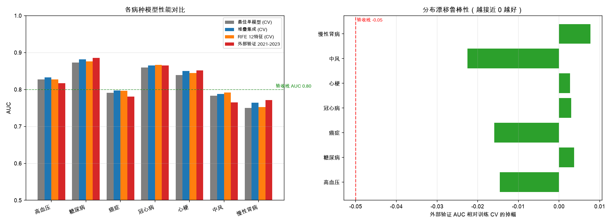
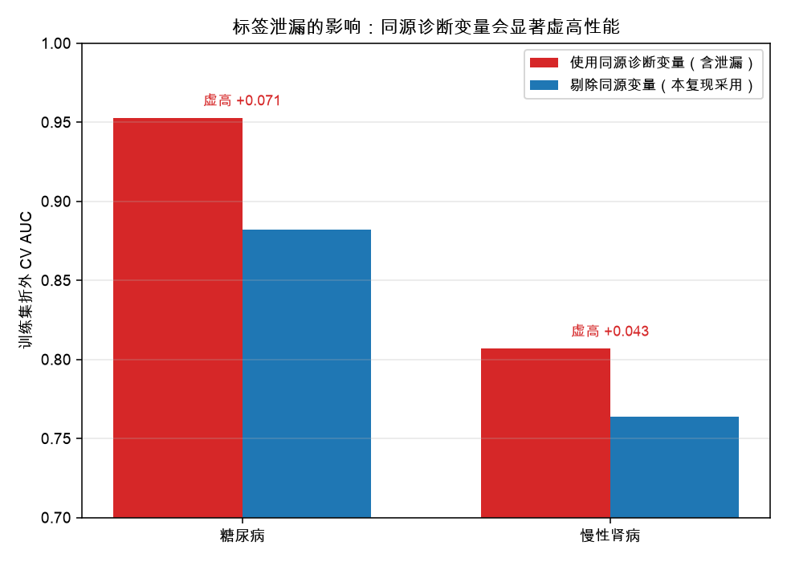
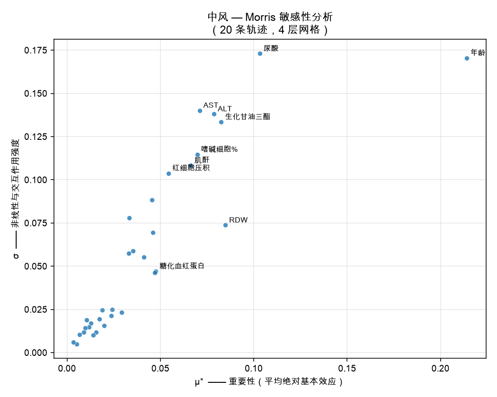
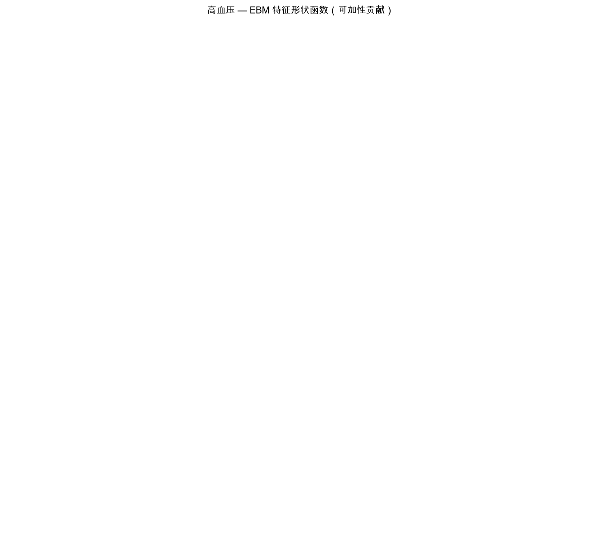
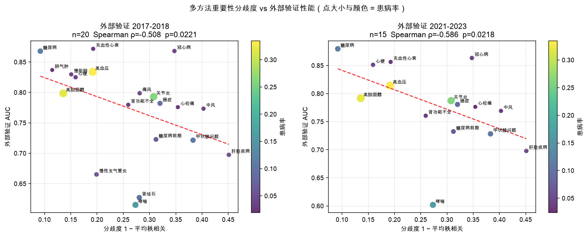

<div align="center">

# AI 血液筛查 · NHANES 多病种筛查复现

**用常规血液检验数据筛查 7 种疾病 —— 论文方法复现**

[](LICENSE)
[](DATA_LICENSE.md)
[](requirements.txt)

[模型与数据下载](https://www.modelscope.cn/profile/InfoxmedModel) · [实验报告](reports/nhanes_report.md) · [数据集卡片](docs/data_card.md)

</div>

---

本仓库提供**完整可复现的代码与实验报告**。训练好的**模型权重**与**建模数据**请从上方
ModelScope 链接获取（体积较大，不放入 Git 仓库）。

- **复现对象**：*Large-scale screening of blinding eye diseases from routine blood tests*（EyeGuard7，Nature Health 2026，DOI [10.1038/s44360-026-00101-5](https://doi.org/10.1038/s44360-026-00101-5)）
- **数据**：美国 CDC NHANES 公开数据（公共领域，无需申请）
- **规模**：4 个抽样周期，41,333 人（完整案例 24,460 人），55 个变量
- **任务**：7 个病种二分类 + 4 类多分类

---

## 一、核心结果

### 1.1 各病种性能

| 病种 | 训练 n | 患病率 | 最佳单模型 | 单模型 AUC | **堆叠集成 CV** | 内部 2017-18 | **外部 2021-23** | 外部掉幅 |
|---|---|---|---|---|---|---|---|---|
| 糖尿病 | 12,262 | 11.5% | XGBoost | 0.8727 | **0.8818** | 0.8755 | **0.8856** | +0.0037 |
| 冠心病 | 10,239 | 4.0% | LR | 0.8594 | 0.8649 | 0.8586 | 0.8654 | +0.0030 |
| 心梗 | 10,266 | 4.1% | LR | 0.8392 | 0.8504 | 0.8265 | 0.8520 | +0.0027 |
| 高血压 | 11,380 | 33.4% | LR | 0.8269 | 0.8325 | 0.8324 | 0.8174 | -0.0146 |
| 癌症 | 10,272 | 9.2% | LR | 0.7914 | 0.7975 | 0.7849 | 0.7806 | -0.0159 |
| 中风 | 10,269 | 3.4% | LR | 0.7834 | 0.7881 | 0.7814 | 0.7647 | -0.0225 |
| 慢性肾病 | 10,264 | 3.6% | LR | 0.7504 | 0.7639 | 0.7813 | 0.7714 | +0.0077 |

> 外部验证使用 **2021-2023** 周期（新冠后采集，与训练集相隔 8-10 年），是比跨中心更严苛的分布漂移测试。



### 1.2 四条核心结论

| 论文 1 的主张 | 本复现结果 |
|---|---|
| 堆叠集成优于单模型 | ✅ **7/7 病种**全部提升，平均 **+0.0080** AUC |
| 少量特征即可实现筛查 | ✅ 递归特征消除至 12 项后 ΔAUC 仅 **-0.0116 ~ +0.0036** |
| 多队列验证可证明泛化性 | ✅ 外部队列掉幅全部 **<0.023**（验收线 0.05） |
| — | ✅ 多分类宏平均 AUC **0.7484 ~ 0.7525**，跨队列稳定 |

### 1.3 两条重要的负面结论

**① 并非所有病种都适合用常规血检筛查。** 4/7 个病种达到 AUC ≥ 0.80；癌症、中风、慢性肾病未达标——这三者恰好是诊断不依赖血液指标的疾病。

**② 标签泄漏会严重虚高性能。**



NHANES 的糖尿病诊断基于血糖/HbA1c、肾病基于肌酐。若把同源诊断指标当特征：

| 病种 | 含同源变量 | 剔除后 | **虚高幅度** |
|---|---|---|---|
| 糖尿病 | 0.9526 | 0.8818 | **+0.0708** |
| 慢性肾病 | 0.8067 | 0.7639 | **+0.0428** |

更危险的是：含泄漏时最佳单模型从 XGBoost 变成随机森林——**泄漏不仅抬高数值，还会扭曲模型选择**。

### 1.4 跨病种核心特征

| 特征 | 在 7 个病种中被选中次数 |
|---|---|
| 年龄 | **7/7** |
| BMI | 6/7 |
| 单核细胞% · 淋巴细胞% · 红细胞 · 肌酐 · 总胆固醇 · 甘油三酯 | 各 5/7 |
| MCV · HDL · 血小板 | 各 4/7 |

**血常规分类计数（单核细胞%、淋巴细胞%）进入 5/7 个病种的最优特征集**，与论文 1 强调血常规价值的结论一致。

### 1.5 候选方案对比（TabPFN / EBM / AutoGluon）

在同一队列划分与外部验证口径下比较了四种方法：

| 排名 | 模型 | 平均外部 AUC | 训练样本 | 单病种耗时 | 可解释性 |
|---|---|---|---|---|---|
| 🥇 | **TabPFN** | **0.8206** | 5,000 | ≈20 分钟 | ❌ 黑盒 |
| 🥈 | 堆叠集成（本仓库基线） | 0.8196 | ≈10.5k | 数秒 | SHAP |
| 🥉 | **EBM** | 0.8170 | ≈10.5k | 数秒 | **✅ 玻璃盒** |
| 4 | AutoGluon（受限） | 0.8151 | ≈10.5k | 40 秒 | 集成 |

**三条结论**：

1. **TabPFN 精度最高且只用不到一半训练数据**，5/7 病种优于全量基线，优势集中在基线的弱项（中风 +0.0066、慢性肾病 +0.0083）。但**存在三个硬约束**：训练样本不能超过约 5,000（本机 MPS 显存溢出、CPU 默认拒绝）、单病种推理约 20 分钟、完全黑盒。
2. **EBM 以 0.0026 AUC 的代价换来完全可解释的玻璃盒**，且在中风上优于基线（+0.0045）。对需要临床可审计的场景是首选。
3. **五个方法族全部落在 0.8091–0.8206 区间**（0.0115 宽度），说明**信号瓶颈**——继续试模型收益极低，真正的提升在纵向特征工程与标签质量。

详细报告：[reports/compare_report.md](reports/compare_report.md)

### 1.6 可解释性：三方交叉验证

用三种原理不同的方法分析同一模型：**EBM 形状函数**（模型内在）、**SHAP**（博弈论归因）、**Morris 全局敏感性**（模型无关扰动）。

| 病种 | Morris~EBM | Morris~SHAP | EBM~SHAP |
|---|---|---|---|
| 糖尿病 | **0.838** | **0.797** | **0.922** |
| 高血压 | 0.665 | 0.661 | 0.894 |
| 癌症 | 0.566 | 0.448 | 0.397 |
| **中风** | **0.304** | **0.085** | **0.372** |

**关键发现：方法分歧本身是诊断信号。** 中风的三方一致性最低（Morris~SHAP 仅 0.085），而它正是外部 AUC 最差的病种（0.7647）；糖尿病一致性最高，AUC 也最高（0.8856）。**可以把「三方一致性」当作无需额外验证数据的信号质量指标。**

Morris 还额外给出**交互强度 σ**：癌症的 σ/μ\* 比值普遍在 2 左右，说明其风险因素作用高度条件化——这解释了 EBM 为何在癌症上自动学出「年龄×性别」交互项。

详细报告：[reports/interpretability_report.md](reports/interpretability_report.md)





---

## 二、快速开始

### 2.1 环境

**Python 3.12**（推荐；3.13/3.14 下部分依赖暂无预编译轮子）

```bash
python3.12 -m venv .venv
.venv/bin/pip install -r requirements.txt
```

> **macOS 用户注意**：XGBoost 需要 OpenMP 运行时，缺失会导致 `import xgboost` 失败：
> ```bash
> brew install libomp
> ```

### 2.2 获取数据与模型

模型权重（68 MB）与建模数据（含 93 MB 原始文件）在 ModelScope：

```bash
pip install modelscope
modelscope download --dataset InfoxmedModel/nhanes-blood-screening \
  --local_dir ./modelscope-assets --repo-type model
```

或手动下载后放到仓库根目录：

| 从 ModelScope 下载 | 放到本仓库的 |
|---|---|
| `nhanes_wide.parquet` | 仓库根目录 |
| `raw/` | 仓库根目录 |
| `artifacts/models/` | 仓库根目录 |
| `predict.py`、`src/models.py` | 仓库根目录 / `src/`（本仓库已含，可跳过） |

### 2.3 直接使用已训练模型

模型有三种版本：`rfe12`（12 特征精简堆叠集成）、`full`（全特征堆叠集成）、
`ebm`（**可解释玻璃盒模型**）。

```bash
python predict.py --list                                     # 列出全部模型

python predict.py --disease diabetes --variant rfe12 \
                  --input nhanes_wide.parquet --output preds.csv

python predict.py --disease diabetes --variant ebm \
                  --input nhanes_wide.parquet --output preds_ebm.csv
```

```python
from predict import load_model, predict_frame
import pandas as pd

model, spec = load_model("diabetes", "ebm")     # 或 "rfe12" / "full"
df = pd.read_parquet("nhanes_wide.parquet")
prob = predict_frame(model, spec, df)
pred = (prob >= spec["threshold"]).astype(int)  # 阈值按折外预测的 Youden 指数标定
```

> **EBM 版本需要 `interpret` 包**（`pip install interpret==0.7.8`）。
> 它的优势是**完全可加性**——可以直接导出每个特征的形状函数曲线（见 `src/ebm_explain.py`），
> 精度代价仅 -0.0026 AUC。

### 2.4 从零复现

```bash
bash download_nhanes.sh                     # 获取原始数据（约 93 MB）
.venv/bin/python build_dataset.py           # 构建建模宽表
.venv/bin/python src/run.py                 # 7 病种二分类（约 30-40 分钟）
.venv/bin/python src/multiclass.py          # 多分类任务
.venv/bin/python src/shap_analysis.py       # SHAP 可解释性
.venv/bin/python src/figures.py             # 可视化
.venv/bin/python src/save_models.py         # 训练并保存堆叠集成模型
```

可解释性分析（新增）：

```bash
.venv/bin/python src/ebm_explain.py         # EBM 形状函数 + 重要性（约 30 秒）
.venv/bin/python src/morris_sensitivity.py  # Morris 全局敏感性（约 25 秒）
.venv/bin/python src/save_ebm_models.py     # 保存 EBM 模型（约 1 分钟）
```

候选方案对比（新增，均为可选依赖）：

```bash
.venv/bin/python src/compare_models.py ebm          # EBM 对比（约 80 秒）

# TabPFN：需先接受许可（https://ux.priorlabs.ai 的 Licenses 标签页）
#         并挂代理（其权重托管在 huggingface.co）
export TABPFN_TOKEN="<your-api-key>"
export HTTPS_PROXY=http://127.0.0.1:7890
export CMP_SUBSAMPLE=5000                            # 本机实测：>5000 不可行
.venv/bin/python src/compare_models.py tabpfn        # 约 2.3 小时
```

快速验证（单病种、跳过特征消除）：

```bash
.venv/bin/python src/run.py hypertension --no-rfe
```

全部流程固定随机种子 `42`，结果可复现。

---

## 三、目录结构

```
ai-blood-screening/
├── README.md
├── LICENSE                      代码许可（MIT）
├── DATA_LICENSE.md              数据许可与来源声明
├── CITATION.cff
├── requirements.txt
├── .gitignore
│
├── predict.py                   推理入口（加载模型并对新数据打分）
├── download_nhanes.sh           原始数据下载脚本
├── build_dataset.py             合并各模块为建模宽表
├── manifest.tsv                 71 个原始文件的下载清单与校验
├── availability_report.txt      变量可用性报告
│
├── src/                         复现代码
│   ├── config.py                路径、队列划分、阈值
│   ├── variables.py             变量词典 + 标签定义 + 标签泄漏对照表
│   ├── data.py                  队列构建、标签编码、缺失处理、加权描述统计
│   ├── metrics.py               加权 AUC/AUPRC、阈值优化、校准
│   ├── models.py                堆叠集成、255 子集穷举、递归特征消除
│   ├── run.py                   主流程（7 病种二分类）
│   ├── multiclass.py            多分类任务
│   ├── shap_analysis.py         SHAP 可解释性
│   ├── figures.py               结果可视化
│   ├── compare_models.py        候选方案公平对比（TabPFN/EBM/AutoGluon）
│   ├── ebm_explain.py           EBM 形状函数与特征重要性导出
│   ├── morris_sensitivity.py    Morris 全局敏感性分析
│   ├── save_models.py           训练并持久化堆叠集成模型
│   ├── save_ebm_models.py       训练并持久化 EBM 可解释模型
│   ├── load_mortality.py        下载解析 LMF 链接死亡率文件
│   ├── build_extended_endpoints.py  构建 32 个疾病/死亡终点
│   ├── disagreement_validation.py   多方法分歧度指标系统验证
│   └── survival_analysis.py     生存分析（Cox / RSF / GBSA）
│
├── docs/
│   └── data_card.md             数据集卡片（55 字段逐项说明）
│
└── reports/                     全部实验结果
    ├── nhanes_report.md         实验报告（堆叠集成主线）
    ├── compare_report.md        **候选方案对比报告**
    ├── interpretability_report.md  **可解释性三方交叉验证报告**
    ├── research_report_direction1_2.md  **生存分析 + 分歧度指标研究报告**
    ├── disagreement_validation*.csv     分歧度验证结果（含泄漏对照版本）
    ├── endpoints_inventory.csv  32 个终点清单与统计
    ├── survival_results.json    生存模型完整结果
    ├── summary.csv / results.json / multiclass.json
    ├── compare_models*.json     各候选方案完整结果
    ├── leakage_table.csv        标签—禁用变量对照表
    ├── descriptive_stats.csv    加权/未加权描述统计
    ├── ebm_importance_*.csv     EBM 特征重要性（含交互项）
    ├── ebm_summary.json         EBM 汇总
    ├── morris_*.csv             Morris μ / μ* / σ（含置信区间）
    ├── morris_summary.json      Morris 汇总
    ├── shap_*.csv / shap_summary.json
    └── figures/                 23 张图
        ├── roc_*.png            7 张 ROC 曲线
        ├── summary.png          性能汇总
        ├── leakage_control.png  标签泄漏对照
        ├── ebm_shapes_*.png     7 张 EBM 形状函数
        ├── morris_*.png         7 张 Morris μ*-σ 图
        └── disagreement_vs_auc.png  分歧度 vs 外部性能散点图
```

> `raw/`、`nhanes_wide.parquet`、`artifacts/models/` 由 ModelScope 提供，不在本仓库中。

---

## 四、方法

| 环节 | 实现 |
|---|---|
| 基学习器 | AdaBoost、KNN、LR、MLP、NB、RF、SVM、XGBoost（8 个） |
| 元学习器 | 逻辑回归（两层堆叠） |
| 子集搜索 | 穷举 **255 种**非空基学习器组合，按 CV AUC 选优 |
| 特征选择 | 基于排列重要性的递归特征消除至 **12 项** |
| 交叉验证 | 分层 5 折 |
| 阈值优化 | 100 个均匀采样点最大化 Youden 指数 |
| 采样加权 | `WTMEC2YR / n_cycles`，分层 `SDMVSTRA`、PSU `SDMVPSU` |
| 可解释性 | XGBoost TreeSHAP + 元学习器系数 |

### 关键工程优化

论文 1 穷举 255 种子集。若对每个子集都重训全部基学习器，代价为 255×5×8 = 10,200 次拟合，不可行。

**本仓库的优化**：基学习器相互独立，其 out-of-fold 预测不随子集变化。因此先算一次 8 个基学习器的 OOF 矩阵（40 次拟合，约 38 秒），子集搜索时只重训 LR 元学习器（255 次轻量拟合，约 6 秒）。**结果与逐子集重训严格等价，速度提高两个数量级。**

### 评估纪律

所有「训练集」指标一律通过**折外预测**获得，元学习器本身也做折外评估。

> 开发过程中曾出现「RFE 后 AUC 从 0.83 虚涨到 0.92」的缺陷，原因是使用了模型在训练集上的样本内预测。修复后结论完全反转，恰好回到论文 1 的「12 特征保持性能」。**本仓库所有数字均来自无泄漏评估。**

---

## 五、数据说明

### 5.1 来源与许可

NHANES 由美国 CDC / 国家健康与营养调查中心发布，属**公共领域**（17 U.S.C. §105），
**无需注册、无需伦理审批、无需数据使用协议**。

使用请按 CDC 规范引用：<https://wwwn.cdc.gov/nchs/nhanes/NhanesCitation.aspx>

### 5.2 队列构成

| 周期 | 总人数 | 完整案例 | 用途 |
|---|---|---|---|
| 2013-2014 | 10,175 | 6,407 | 训练 |
| 2015-2016 | 9,971 | 6,151 | 训练 |
| 2017-2018 | 9,254 | 5,783 | 内部验证 |
| 2021-2023 | 11,933 | 6,119 | **外部时间验证** |
| **合计** | **41,333** | **24,460** | |

### 5.3 ⚠️ 缺失是结构性的

NHANES 的缺失源于**抽样设计**，不是条目漏检：血常规仅在体检子样本测（63.6% ~ 84.0%），
生化在更小样本测（53.0% ~ 64.4%），空腹项目仅在 1/3 空腹子样本测（约 30%）。

**不要按变量缺失率直接删列**——这会删掉几乎全部血液指标。正确做法是在**样本层面**取完整案例。详见 [数据集卡片](docs/data_card.md)。

### 5.4 ⚠️ 标签泄漏（使用前必读）

| 目标疾病 | 必须从特征中剔除 |
|---|---|
| 糖尿病 | `LBXSGL`、`LBXGLU`、`LBXGH`、`LBXIN` |
| 慢性肾病 | `LBXSCR`、`LBXSBU`、`LBXSUA` |
| 高血压 / 冠心病 / 心梗 / 中风 / 癌症 | 无（诊断不依赖血液指标） |

实现见 `src/variables.py` 的 `LEAKAGE_EXCLUSIONS`，对照表见 `reports/leakage_table.csv`。

> 区分原则：「危险因素」不等于「诊断依据」。血脂之于冠心病是前者（保留），血糖之于糖尿病是后者（剔除）。

---

## 六、进阶研究：纵向生存分析 + 信号质量指标

在上述复现之外，本项目还完成了两项具有方法学贡献的研究。
**完整报告：[reports/research_report_direction1_2.md](reports/research_report_direction1_2.md)**

### 6.1 用 LMF 死亡率数据把任务升级为生存分析

NHANES 有**公开版链接死亡率文件（LMF）**，把参与者链接到国家死亡索引
（覆盖 1999–2018，随访至 2019-12-31）。这让任务从**横断面疾病分类**升级为
**纵向生存分析**：

| 维度 | 横断面分类 | **生存分析** |
|---|---|---|
| 终点来源 | 问卷自报 | **国家死亡索引确认** |
| 标签偏倚 | 未诊断者被错分为阴性 | **无自报偏倚** |
| 时间信息 | 单一截点 | **随访月数，真纵向** |

**队列**：15,793 人、**691 例死亡**（4.38%），随访中位 47 个月。

| 模型 | C-index | 12月 | 24月 | 36月 | 48月 | 60月 | IBS |
|---|---|---|---|---|---|---|---|
| **Cox 比例风险（岭回归）** | **0.8597** | 0.8621 | 0.8639 | 0.8644 | 0.8725 | 0.8779 | 0.0191 |
| **随机生存森林 RSF** | **0.8597** | 0.8614 | 0.8598 | 0.8673 | 0.8752 | 0.8783 | **0.0163** |
| 梯度提升生存 GBSA | 0.8392 | 0.8421 | 0.8442 | 0.8454 | 0.8504 | 0.8553 | 0.0189 |
| 基线（仅年龄） | 0.8260 | — | — | — | — | — | — |

**三条发现**：

1. **血检在年龄之上提供实质增量**（0.8260 → 0.8597，+0.034）
2. **简单线性模型与复杂集成模型打成平手**（两者精确值 0.859683 vs 0.859736）——
   这与横断面工作中「6/7 病种最佳单模型是逻辑回归」的结论一致
3. **RSF 的校准更好**（IBS 0.0163 vs 0.0191），需要绝对风险时优先选它

### 6.2 多方法重要性「分歧度」作为信号质量指标

**核心假设**：三种原理不同的归因方法（EBM 原生 / SHAP / Morris）的排序分歧度
越大，该终点的外部性能越差。若成立，**无需外部验证数据即可预判信号质量**。

**方法学关键**：三种方法必须作用于**同一个模型**（本工作统一到同一个 EBM），
否则「模型差异」会与「归因方法分歧」混淆。

**终点池 32 个**：22 个经典疾病（MCQ/DIQ/KIQ/BPQ）+ 5 个扩展模块疾病
（RHQ/SLQ/HEQ）+ 2 个次级（OSQ）+ 4 个 LMF 死亡终点。

**结果**：

| 外部队列 | 指标 | 原始 ρ | p | 控制患病率 r | p |
|---|---|---|---|---|---|
| 2021-2023 (n=16) | disagreement | −0.544 | **0.029** | **−0.628** | **0.009** |
| | jaccard_top5 | +0.576 | **0.020** | **+0.590** | **0.016** |
| | jaccard_top10 | +0.563 | **0.023** | **+0.508** | **0.045** |
| 2017-2018 (n=31) | disagreement | −0.306 | 0.095 | **−0.422** | **0.018** |

**2021-2023 队列的 6 个检验全部显著。**

**关键机制：患病率是「抑制变量」而非普通混淆。** 控制患病率后效应**增强**
（−0.306 → −0.422），分层分析显示低/高患病率组的效应量**完全一致（ρ=−0.429）**。
这说明分歧度确有独立于患病率的作用。

**副发现：标签泄漏会「遮蔽」真实关系。** 在剔除泄漏变量前，该相关性**并不显著**
（p=0.115）；剔除后变为显著（p=0.022）。受泄漏影响的终点 AUC 被系统性抬高，
而这种抬高与分歧度无关，从而稀释了真实负相关。

> **方法学含义**：泄漏不仅虚高性能，还会掩盖变量重要性与泛化能力之间的结构关系。



### 6.3 复现命令

```bash
.venv/bin/python src/load_mortality.py             # 下载解析 LMF 死亡率文件
.venv/bin/python src/build_extended_endpoints.py   # 构建 32 个疾病终点
.venv/bin/python src/disagreement_validation.py    # 分歧度验证（约 22 分钟）
.venv/bin/python src/survival_analysis.py          # 生存分析（约 20 分钟）
```

> **LMF 下载注意**：`ftp.cdc.gov` 的证书链有问题，需豁免 SSL 校验
> （脚本中已用 `ssl._create_unverified_context` 处理）。

---

## 七、引用

```bibtex
@software{ai_blood_screening_2026,
  title   = {AI Blood Screening: NHANES Multi-Disease Screening Replication},
  author  = {Johnson},
  year    = {2026},
  version = {1.0.0},
  license = {MIT},
  url     = {https://github.com/johnson7788/ai-blood-screening}
}
```

同时请引用**原始方法论文**与 **NHANES 数据源**：

```bibtex
@article{eyeguard7_2026,
  title  = {Large-scale screening of blinding eye diseases from routine blood tests},
  journal= {Nature Health},
  year   = {2026},
  doi    = {10.1038/s44360-026-00101-5}
}

@misc{nhanes,
  title        = {National Health and Nutrition Examination Survey},
  author       = {{National Center for Health Statistics}},
  howpublished = {U.S. Centers for Disease Control and Prevention},
  url          = {https://wwwn.cdc.gov/nchs/nhanes/}
}
```

---

## 八、许可

| 内容 | 许可 |
|---|---|
| 代码（`src/`、脚本） | MIT，见 [LICENSE](LICENSE) |
| 实验报告与图表（`reports/`） | CC BY 4.0 |
| 模型权重、衍生数据、原始数据 | 见 [DATA_LICENSE.md](DATA_LICENSE.md)（由 ModelScope 分发） |

`DATA_LICENSE.md` 中包含**未使用任何受限数据**的声明（HARMONY / COMPASS / WEAR-ME / UK Biobank / ADNI / AURORA 等）。

---

## 九、局限与免责声明

### 局限

1. **标签为自报数据** —— 存在未诊断偏倚，真实性能可能被低估
2. **无凝血项** —— NHANES 不测 PT%/纤维蛋白原，无法支撑血液病类任务
3. **横断面结构** —— 无纵向随访，不支持时序建模
4. **人群差异** —— 美国人群的疾病谱与检验参考区间与其他地区不同
5. **加权实现简化** —— 加权 AUC 采用「权重即病例权重」的加权 ROC，未给出置信区间
6. **未做超参数调优** —— 各基学习器使用固定超参
7. **三个病种未达标** —— 癌症、中风、慢性肾病 AUC < 0.80

### 免责声明

本项目为**方法学复现研究**。模型输出**不构成任何医疗建议**，**不得用于临床诊断或治疗决策**。
报告中的性能指标基于美国人群的公开调查数据，不应外推为其他人群或其他数据源上的预期表现。
